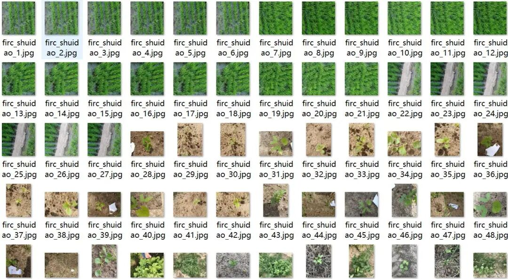
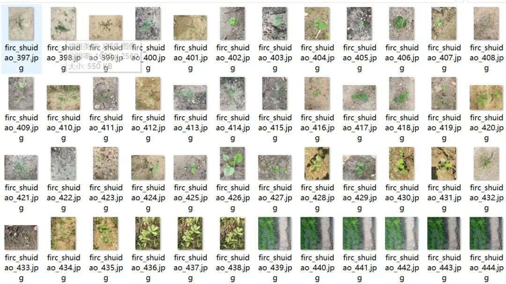
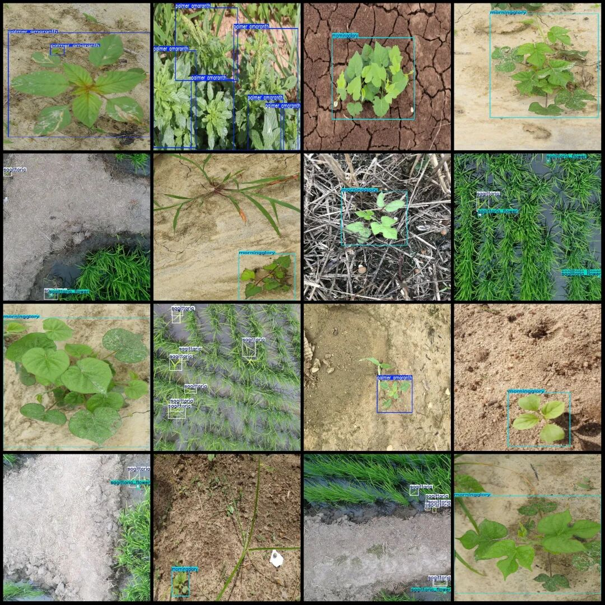
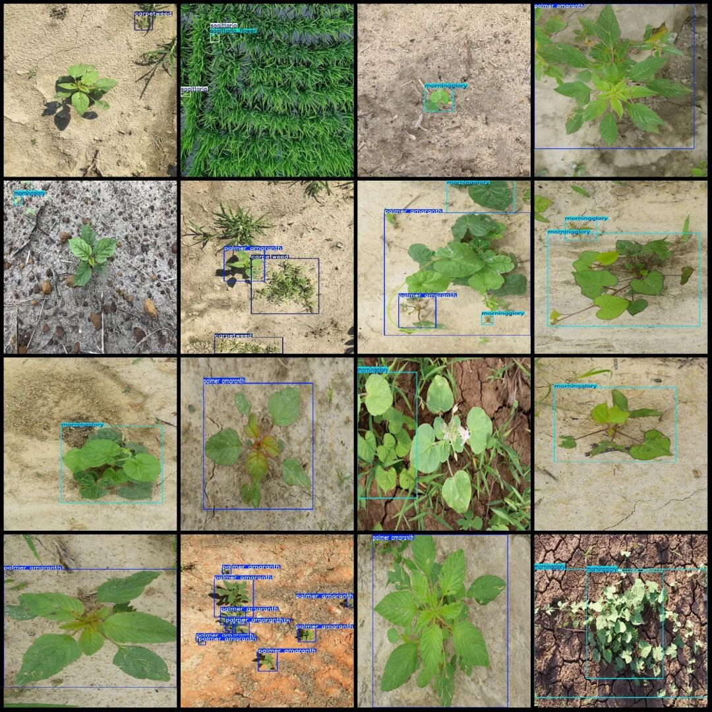

# UAV Perspective Rice Weed Detection Dataset VOC+YOLO format with 625 images in 5 categories

Dataset format: Pascal VOC format + YOLO format (txt file without split path, only containing jpg images and corresponding VOC format xml files and yolo format txt files)

Number of images (number of jpg files): 625

Number of annotations (number of xml files): 625

Number of annotations (number of txt files): 625

Label category count: 5

Label category names (note that the order of yolo format categories does not correspond to this, but is based on the labels folder's classes.txt): ["carpetweed", "morningglory", "palmer amaranth", "sagittaria", "sagittaria_flower"]

Number of boxes labeled in each category:

Carpetweed (sorghum grass) frame count = 235

Morningglory (Ipomoea purpurea) frame count = 250

Palmer amaranth (Long-spike amaranth) frame count = 304

Sagittaria (Typhae) Frames = 729

Sagittaria flower (Typha angustifolia) frame count = 505

Total frames: 2023

Image resolution: Multi-resolution images, such as 1920x1280, 1920x1920, etc.

Drone: DJI MAVIC 3

Collection height: 5-10m

Sampling angle: 90°

Application Scenarios: Used for detecting foreign objects in agricultural land, agricultural statistical analysis, yield estimation, and low-altitude target detection in the field of digital agriculture among researchers.

Using labelImg:

Annotation rules: Draw a rectangle around the category.

Important Notice: No

Special : This dataset does not guarantee the accuracy of the trained models or weight files.

Image Preview:

Annotation example:

## Payment

Here is a pay link on Stripe ( https://buy.stripe.com/3cs8yP7sY87d0vu9AB ). Please contact me lonlonago@foxmail.com after funding $89, and I will send you a complete data files , thank you!

